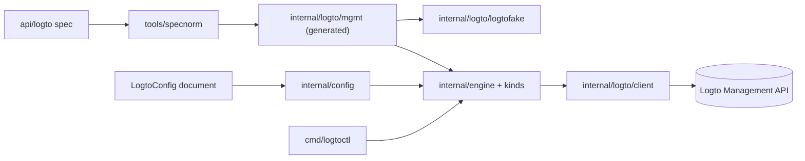

# Architecture

## Stack

- Go: one static binary for the CLI, the cluster-operator norm for the controller.
- `oapi-codegen` generates the Management API client, types and a chi server from Logto's vendored OpenAPI spec.
- `mise` pins every tool, `task` is the only entry point.

## How it fits together

## Key decisions

- Management API only, never a database write: whatever the API cannot do (first credential, declared ids) stays a
  manual step.
- The vendored spec is the source and is never edited; generator workarounds live in `tools/specnorm` (literal
  `format` rewrite, overlays that fail when their target moves).
- `oapi-codegen` over `ogen`: `ogen` skipped 46 operations of Logto's spec, including sign-in experience, connectors
  and custom profile fields.
- Generated code is committed and guarded by `task generate:check`, which always regenerates.
- Users and organizations are data, not configuration: no kind creates, updates or prunes them (nor memberships,
  passwords); console admins stay manual.
- Engine first, operator second: the CLI and the controller are thin shells over the same engine.
- One schema, `logto.aliud.fr/v1alpha1` (`api/v1alpha1`): the Go types generate the CRD (controller-gen) and the
  JSON Schema of the CLI file (`tools/crd2schema`); nothing is written twice.
- Kinds own their wire types (only the fields they manage) and send them through the generated request builders
  (`client.Do`); contract tests validate them against every vendored spec of the window (`internal/logto/contract`),
  and the engine refuses at plan time a field the target's own spec lacks (`internal/logto/capability`).
- The engine (`internal/engine`) runs kinds in `DependsOn` order: Plan observes and diffs; Apply runs the ops, then
  plans the kind again and fails if Logto did not keep the write. No state file: Logto is the state.
- A kind matched by a natural key plans through `kindkit.Collection` (create, update, refuse an ambiguous match,
  prune with `keep`); the fake's collections share `table` (generated id, unique name, 422, 404).
- A sub-object Logto replaces whole is sent as the declared value over Logto's own (`kindkit.Overlay`): unmanaged
  fields survive. Deletes run after every create and update, kinds in reverse order; apply results are per op
  (`plan.Result`), failures `*engine.OpError`, `engine.Transient` says whether a retry may help.
- The target's version is its spec: `internal/logto/version.Match` fingerprints it (without `servers`) against the
  vendored ones; an unknown one is refused unless `--allow-untested-logto`. The binary carries only the fingerprints
  (generated); the specs, raw and normalized (`<version>.normalized.json`, what tests load), stay test-only.
- Secret values are read only during an apply (`engine.Publisher`); a plan never holds one, and a sensitive change
  is masked as it enters a plan.
- A document is loaded strictly (`internal/config`): unknown keys fail with their path, `${name}` comes from
  `spec.variables` only, the generated JSON Schema is checked on the document as written (what the CRD refuses),
  files are resolved relative to the document, then the rules across fields; each step reports every violation.

## Gotchas

- Logto encodes zod literals as `"format": "\"Value\""`; the generator's loader refuses it raw.
- `oapi-codegen` maps OpenAPI `number` to `float32`: epoch milliseconds lose precision through those fields.
- The spec says `info.version: Cloud`: a route's presence does not prove it works on OSS.
- Logto writes `pattern` as JavaScript literals (`/^#...$/i`) and zod unions as `oneOf` meaning `anyOf`: the
  validation loader (`internal/logto/openapi`) converts both, or valid values are refused.
- Logto exports fields checked by a custom zod function (redirect URIs, names...) as empty objects "Validator
  function": `specnorm` leaves them unconstrained, or the generated client cannot decode real answers.
- YAML flow sequences break on `${...}`: quote such strings (`["https://app.${zone}"]`).
- The operator turns a LogtoConfig object into a document through `config.FromObject` (the CLI's steps, no file
  read), runs the engine once per reconcile (Observe plans, Apply applies), and refuses a
  second object on one endpoint (normalized), one run per endpoint at a time. Its cache holds only the outputs it
  labels; credentials are read uncached, from Secrets whose `logto.aliud.fr/readable-by` annotation lists the endpoint (and token endpoint), secretKeyRef
  only, all before the first call.
- Each reconcile logs one line (`reconciled`, `log.FromContext`): object, endpoint, mode, outcome, counts, Logto
  version, next resync. Every error of a run leaves it through the redactor (`outcome.redacted`), for the status
  and the log alike (`internal/operator/log_test.go`).
