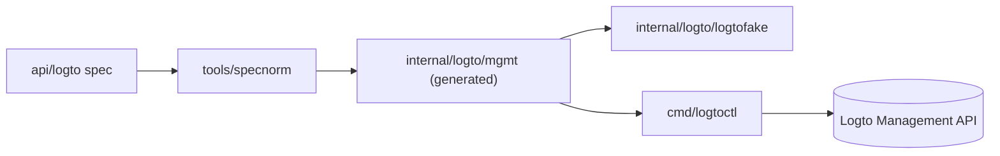

# Architecture

## Stack

- Go: one static binary for the CLI, the cluster-operator norm for the controller.
- `oapi-codegen` generates the Management API client, types and a chi server from Logto's vendored OpenAPI spec.
- `mise` pins every tool, `task` is the only entry point.

## How it fits together

## Key decisions

- Management API only, never a database write: whatever the API cannot do (first credential, declared ids) stays a
  manual step.
- The vendored spec is the source and is never edited; generator workarounds live in `tools/specnorm` (literal
  `format` rewrite, overlays that fail when their target moves).
- `oapi-codegen` over `ogen`: `ogen` skipped 46 operations of Logto's spec, including sign-in experience, connectors
  and custom profile fields.
- Generated code is committed and guarded by `task generate:check`, which always regenerates.
- Engine first, operator second: the CLI and the controller are thin shells over the same engine.
- One schema, `logto.aliud.fr/v1alpha1` (`api/v1alpha1`): the Go types generate the CRD (controller-gen) and the
  JSON Schema of the CLI file (`tools/crd2schema`); nothing is written twice.
- A document is loaded strictly (`internal/config`): unknown keys fail with their path, `${name}` comes from
  `spec.variables` only, files are resolved relative to the document, then every schema rule runs at once.

## Gotchas

- Logto encodes zod literals as `"format": "\"Value\""`; the generator's loader refuses it raw.
- `oapi-codegen` maps OpenAPI `number` to `float32`: epoch milliseconds lose precision through those fields.
- The spec says `info.version: Cloud`: a route's presence does not prove it works on OSS.
- YAML flow sequences break on `${...}`: quote such strings (`["https://app.${zone}"]`).
