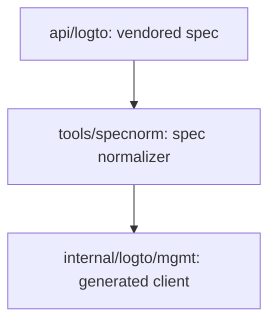

# Codebase Map

## Areas

- `api/logto/`: the Management API spec, vendored byte for byte, and how to refresh it.
- `tools/specnorm/`: turns the spec into valid input for the generator.
- `internal/logto/mgmt/`: generated code plus its three `oapi-codegen` configs; `doc.go` is the only hand-written file.

## Entry points

- `task generate`: the generation chain, from the spec to the client.
