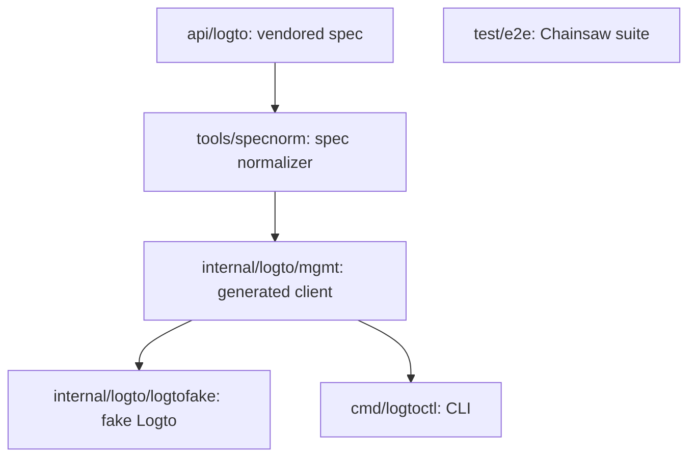

# Codebase Map

## Areas

- `api/logto/`: the Management API spec, vendored byte for byte, and how to refresh it.
- `tools/specnorm/`: turns the spec into valid input for the generator.
- `internal/logto/mgmt/`: generated code plus its three `oapi-codegen` configs; `doc.go` is the only hand-written file.
- `internal/logto/logtofake/`: in-process fake on the generated server; unmodelled routes answer 501.
- `cmd/logtoctl/`: the CLI.
- `test/e2e/`: Chainsaw tests and the k3d cluster config.

## Entry points

- `cmd/logtoctl/main.go`.
