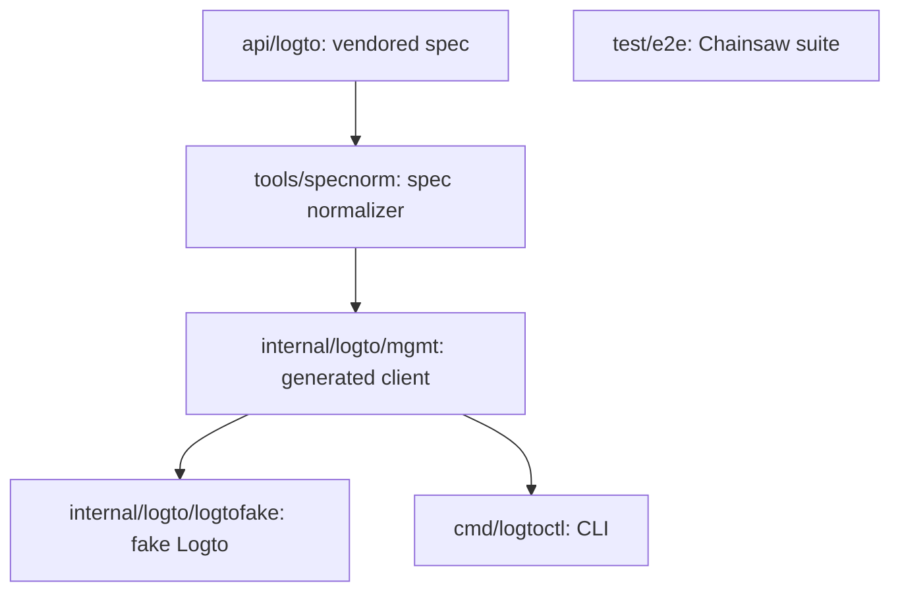

# Codebase Map

## Areas

- `api/logto/`: one vendored spec per Logto version of the support window, and how to move the window.
- `tools/specnorm/`: turns the spec into valid input for the generator.
- `api/v1alpha1/`: the `LogtoConfig` types (source) and the generated deepcopy and JSON Schema; the CRD is
  generated into `config/crd/`.
- `internal/config/`: loads and validates a document.
- `examples/reference.yaml`: every M1 kind, with example names; the acceptance tests apply it.
- `tools/crd2schema/`: extracts the JSON Schema of the CLI file from the CRD.
- `tools/specdiff/`: classifies the differences between two vendored specs; `used.txt` lists the operations used.
- `internal/logto/mgmt/`: generated code plus its three `oapi-codegen` configs; `doc.go` is the only hand-written file.
- `internal/logto/logtofake/`: in-process fake on the generated server; unmodelled routes answer 501.
- `cmd/logtoctl/`: the CLI.
- `test/integration/`: the throwaway Logto (compose, bootstrap) and the integration tests;
  `internal/logto/integration/` loads its credentials.
- `test/e2e/`: Chainsaw tests and the k3d cluster config.

## Entry points

- `cmd/logtoctl/main.go`.
