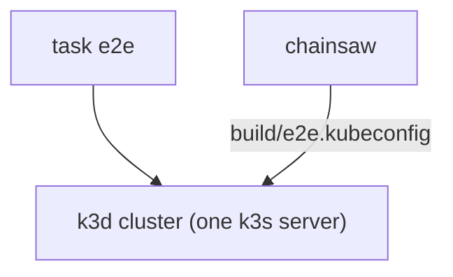

# Infrastructure

## Tooling

- k3d (k3s in Docker) for the throwaway e2e cluster, defined in `test/e2e/k3d.yaml`, image pinned.
- Chainsaw for the tests, configured in `test/e2e/.chainsaw.yaml`.

## Topology

## Conventions

- The suite uses its own kubeconfig file and never touches the developer's current context.
- Each Chainsaw test runs in a fresh namespace, deleted afterwards.
- The k3s image minor matches the pinned `kubectl`.
