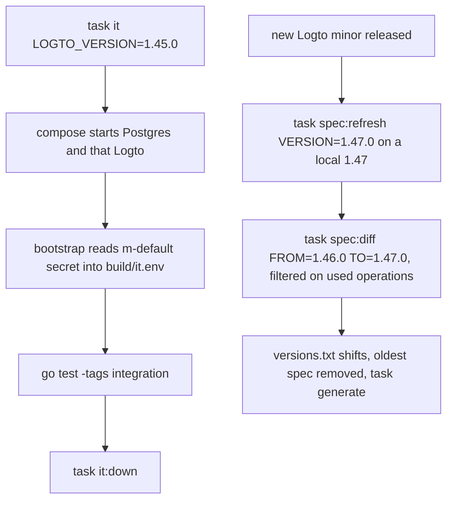

<!-- Fill or omit these sections; never add, rename, or reorder one. -->

# Instruction: support window and integration harness — three vendored specs, a real Logto of each version

## Architecture projection

> Tree of the final files. ✅ create · ✏️ modify · ❌ delete

```txt
.
├── api/logto/
│   ├── versions.txt                    ✅ the support window, newest first: 1.46.0, 1.45.0, 1.44.0
│   ├── 1.46.0.openapi.json             ✅ vendored as served by Logto 1.46.0 (source of the generated client)
│   ├── 1.45.0.openapi.json             ✅ vendored as served by Logto 1.45.0 (contract tests)
│   ├── 1.44.0.openapi.json             ✅ renamed from management.openapi.json (contract tests)
│   ├── management.openapi.json         ❌ replaced by the per-version files
│   └── README.md                       ✏️ the window, how to add a version and drop the oldest
├── internal/logto/mgmt/                ✏️ regenerated from 1.46.0 (configs point at the newest spec)
├── tools/specdiff/                     ✅ diff of two specs, classified breaking / changed / additive, filterable by operation (+ test)
├── test/integration/
│   ├── compose.yaml                    ✅ Postgres + Logto `${LOGTO_VERSION}` (seed, alteration, start), 127.0.0.1:3001/3002
│   ├── bootstrap.sh                    ✅ reads m-default's secret from the throwaway DB into build/it.env (0600)
│   └── harness_test.go                 ✅ build tag `integration`: token via m-default, list applications
├── internal/logto/integration/env.go   ✅ build tag `integration`: loads build/it.env, skips with a clear message if absent
├── .github/workflows/integration.yml   ✅ pull requests: newest version; main: the whole window as a matrix
├── Taskfile.yaml                       ✏️ it:up, it:down, it, spec:refresh VERSION=, spec:diff FROM= TO=; generate reads versions.txt
├── tools/specnorm/                     ✏️ test runs over every vendored spec
└── aidd_docs/memory/testing.md, deployment.md, integration.md ✏️ window, harness, workflow
```

## User Journey



## Test Scope

```mermaid
---
title: Test scope
---
journey
  section Setup
    task it:up LOGTO_VERSION=1.46.0 => Logto answers /api/status on 127.0.0.1:3001: 5: cli
    bootstrap => build/it.env exists, mode 0600: 5: cli
  section Happy path
    harness test => token at the admin endpoint, applications listed at the tenant endpoint: 5: cli
    same run with LOGTO_VERSION=1.44.0 and 1.45.0 => same result: 5: cli
  section Edge case - spec refresh
    task spec:refresh VERSION=1.46.0 on a running 1.46 => vendored file byte-identical: 1: cli
  section Edge case - spec diff
    task spec:diff FROM=1.44.0 TO=1.46.0 => 7 breaking changes, none on a used operation; exit 0: 1: cli
    a used operation loses a property => spec:diff => exit 1 naming it: 1: cli
  section Edge case - no harness
    build/it.env absent => go test -tags integration => skipped with "run task it:up": 1: cli
  section Teardown
    task it:down => no container, no volume left: 5: cli
```

## Tasks to do

### `1)` Vendor the window

> Three specs, each byte-identical to what its Logto serves; the newest generates the client.

1. `compose.yaml` with `LOGTO_VERSION` (default: newest of `versions.txt`), ports on 127.0.0.1, `ENDPOINT=http://localhost:3001`.
2. `task spec:refresh VERSION=x`: starts that version, `curl http://localhost:3001/api/swagger.json | jq -Sc .` (the `servers` entry echoes the request host, so always `localhost:3001`), refuses an empty `paths`.
3. Vendor 1.44.0 (rename, must stay byte-identical), 1.45.0, 1.46.0; `versions.txt`; generator configs read the newest; `task generate` and `generate:check` green; `specnorm`'s test covers every vendored file.

### `2)` Spec diff tool

> Each new minor is judged by a diff, not by reading.

1. `tools/specdiff` (Go, with tests): operations and parameters added or removed, request and response properties added or removed, required changes, type and enum changes; classified breaking, changed, additive.
2. Filter by a list of used operation ids (`tools/specdiff/used.txt`, empty until the kinds exist); exit 1 only on a breaking change of a used operation.
3. `task spec:diff FROM= TO=`; the 1.44.0 to 1.46.0 run reproduces the measured result (7 breaking, none used).

### `3)` Harness and bootstrap credential

> Integration tests get Management API access with no manual step.

1. `bootstrap.sh`: m-default's secret read with `psql` inside the throwaway Postgres, written to `build/it.env` under `umask 077`, never echoed; a missing row fails with a clear message.
2. `internal/logto/integration/env.go` and `harness_test.go`: token at the admin endpoint for `https://default.logto.app/api`, `ListApplications` through the generated client.
3. `task it:up`, `it:down` (`--volumes`), `it` (up, bootstrap, `go test -tags integration -count=1 ./...`); `task check` does not run it.

### `4)` CI workflow

> The window is proven on every merge, pull requests stay cheap.

1. `integration.yml`: GitHub-hosted runner; pull requests run the newest version; pushes to `main` run a matrix over `versions.txt`; `task it:down` in `if: always()`; caches restored, saved on `main` only; path filters.
2. `task ci:runners` and actionlint green; memory files updated (window, harness, workflow).

## Test acceptance criteria

| Task | Acceptance criteria |
| ---- | ------------------- |
| 1 | The three vendored specs are each byte-identical to a fresh `spec:refresh` of their version; the client generated from 1.46.0 compiles and `generate:check` is green. |
| 2 | `task spec:diff FROM=1.44.0 TO=1.46.0` reports 7 breaking changes outside the used operations and exits 0; a fixture where a used operation loses a property exits 1 naming it. |
| 3 | `task it` passes the harness test against 1.44.0, 1.45.0 and 1.46.0; the secret appears in no output; without the stack the tests skip with the instruction. |
| 4 | The integration workflow passes on its pull request (newest version) and on `main` (all three); no container or volume is left. |
