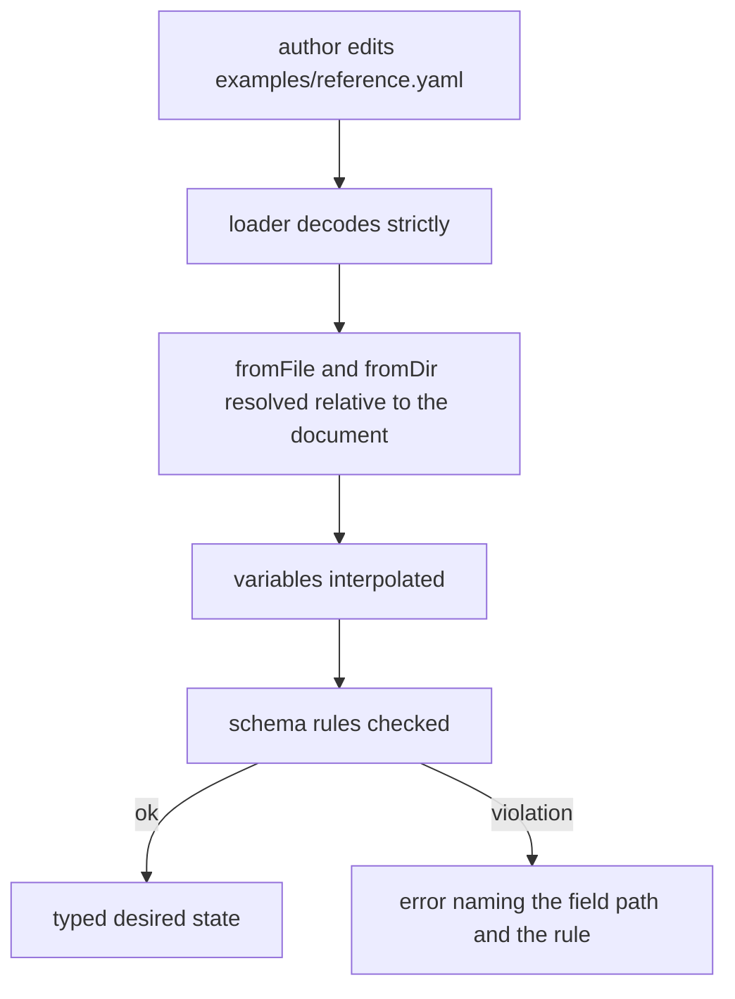
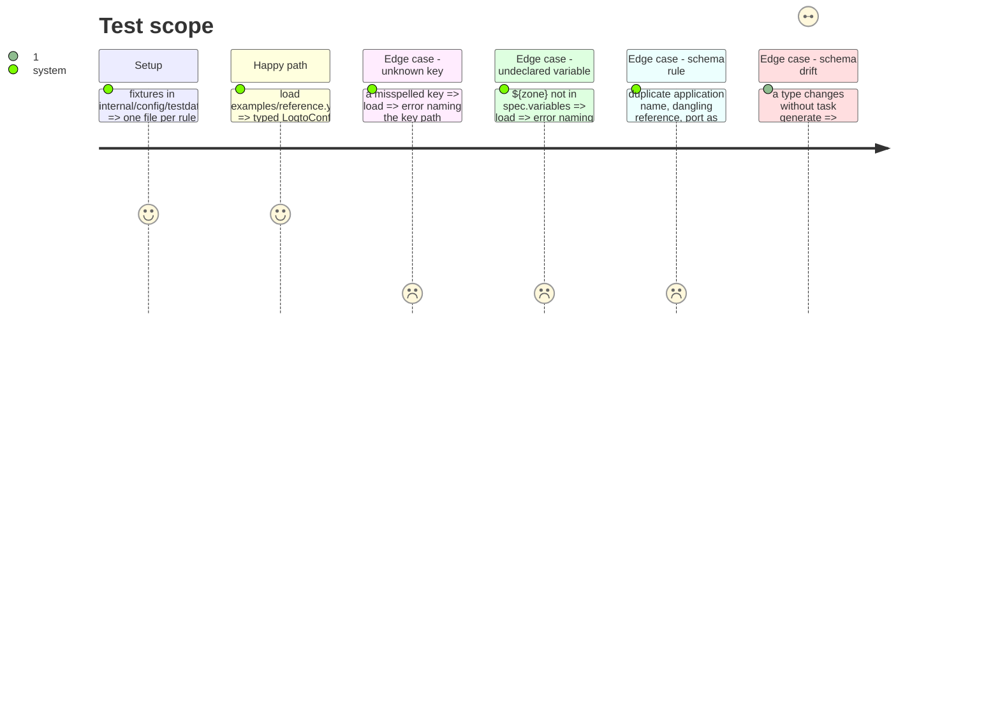

<!-- Fill or omit these sections; never add, rename, or reorder one. -->

# Instruction: `LogtoConfig` schema, generated CRD and JSON Schema, loader and its rules

## Architecture projection

> Tree of the final files. ✅ create · ✏️ modify · ❌ delete

```txt
.
├── api/v1alpha1/
│   ├── groupversion_info.go            ✅ group logto.aliud.fr, version v1alpha1
│   ├── logtoconfig_types.go            ✅ LogtoConfig, spec of the M1 kinds, SecretSource, FileSource, status sketch
│   ├── zz_generated.deepcopy.go        ✅ generated (controller-gen)
│   └── logtoconfig.schema.json         ✅ generated: JSON Schema of the CLI file, extracted from the CRD
├── config/crd/logto.aliud.fr_logtoconfigs.yaml ✅ generated CRD
├── tools/crd2schema/                   ✅ extracts openAPIV3Schema from the CRD into JSON Schema (+ test)
├── internal/config/
│   ├── load.go                         ✅ strict YAML decode, fromFile/fromDir, `${var}` interpolation
│   ├── validate.go                     ✅ schema rules (section 3 of docs/plan.md)
│   └── load_test.go, validate_test.go  ✅ one test per rule, valid and invalid fixtures
├── internal/config/testdata/           ✅ fixtures
├── examples/reference.yaml             ✅ every M1 kind, `example` names, secrets by `valueFrom`
├── examples/reference/                 ✅ logo.svg, custom.css, email-templates/ referenced by fromFile/fromDir
├── mise.toml                           ✏️ controller-gen pinned
├── Taskfile.yaml                       ✏️ generate runs controller-gen and crd2schema; generate:check covers them
└── aidd_docs/memory/architecture.md, codebase-map.md ✏️ schema chain
```

## User Journey



## Test Scope



## Tasks to do

### `1)` Types and generation

> One Go type is the schema of the CLI file and of the CR.

1. `api/v1alpha1` with kubebuilder markers: `LogtoConfigSpec` (endpoint, credentials, variables, prune, connectors, customProfileFields, signInExperience, resources, organizationScopes, organizationRoles, applications, users, outputs), local keys as maps, `SecretSource` (`valueFrom.env|file|secretKeyRef`), `FileSource` (`fromFile`, `fromDir`, `as: dataUri|text`).
2. Pin `controller-gen` in mise (go backend); `task generate` writes deepcopy and the CRD.
3. `tools/crd2schema` (with its test) writes `api/v1alpha1/logtoconfig.schema.json` from the CRD; `generate:check` covers the three outputs.

### `2)` Loader

> Read a document the way a reviewer reads it.

1. Strict decode (`sigs.k8s.io/yaml`, unknown fields rejected), `apiVersion`/`kind` checked.
2. `fromFile`/`fromDir` relative to the document, `as: dataUri` for images; a missing file is an error with its path.
3. `${name}` interpolation in string fields from `spec.variables` only; unknown name is an error; `$${` escapes.

### `3)` Schema rules

> Every trap is refused at load time, not by Logto three calls later.

1. Unique Logto names per kind; every reference resolves (scopes, resources, roles, applications).
2. Scope names without whitespace; SMTP `port` is a number, `auth` non-empty, templates include `Register`, `SignIn`, `ForgotPassword`.
3. Distinct resource indicators; `type` of an application is one of the spec's enum values.
4. Errors carry the field path (`spec.applications.organizer.type`) and are all reported at once.

### `4)` Reference configuration

> One committed document exercises every M1 kind.

1. `examples/reference.yaml` with `example` names, variables for the zone, secrets by `valueFrom.env`, branding and CSS by `fromFile`, templates by `fromDir`.
2. A test loads and validates it; update `architecture.md` and `codebase-map.md`.

## Test acceptance criteria

| Task | Acceptance criteria |
| ---- | ------------------- |
| 1 | `task generate` produces deepcopy, CRD and JSON Schema; changing a type without regenerating makes `task generate:check` fail. |
| 2 | The reference document loads with files inlined and variables replaced; an unknown key or variable fails with its path. |
| 3 | Each rule has a fixture that fails with the rule's message and path, and the reference document passes them all. |
| 4 | `examples/reference.yaml` loads and validates in a unit test, without network. |
