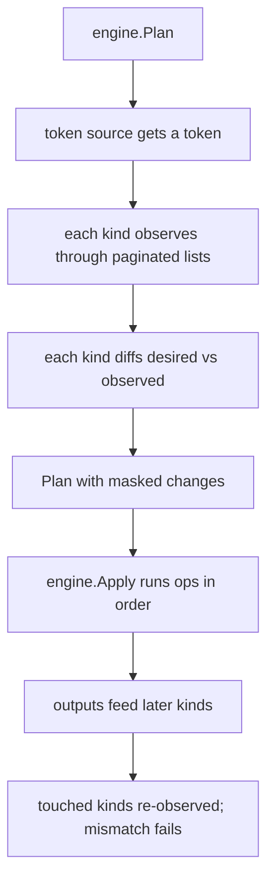
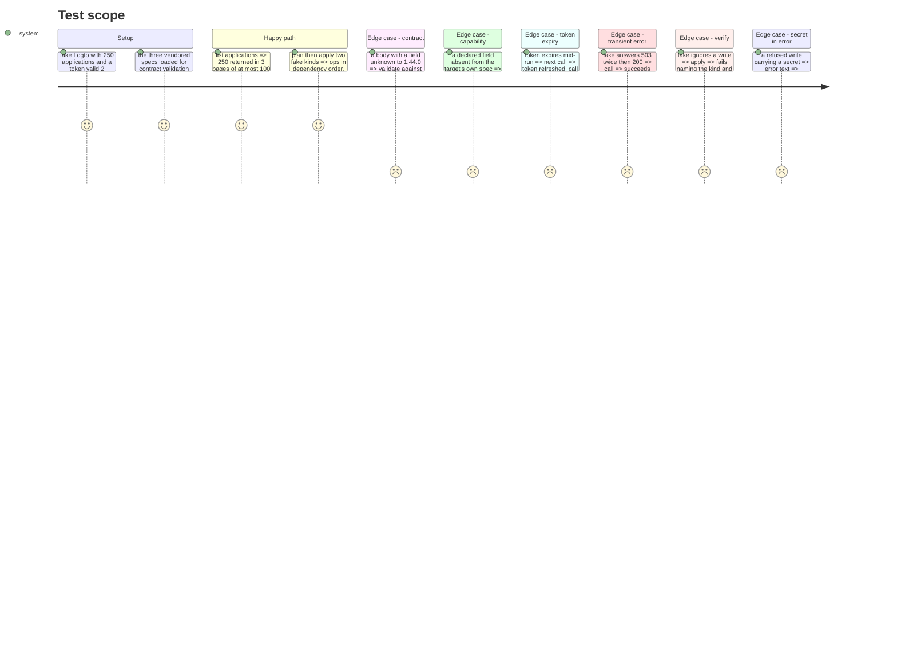

<!-- Fill or omit these sections; never add, rename, or reorder one. -->

# Instruction: Logto client, contract tests, capability check, engine core

## Architecture projection

> Tree of the final files. ✅ create · ✏️ modify · ❌ delete

```txt
.
├── internal/logto/client/
│   ├── token.go            ✅ client_credentials (Basic), optional token endpoint, refresh before expiry
│   ├── client.go           ✅ wraps mgmt.ClientWithResponses: bearer, bounded retries on 5xx/429, timeouts;
│   │                          Do(op, params, body any) sends a kind's own body through the raw-body variant and
│   │                          decodes the response into the kind's own type
│   ├── pages.go            ✅ list helper: page_size 100, loops until a short page
│   ├── errors.go           ✅ errors carry method, path, status, Logto's error code; never a request body
│   └── *_test.go           ✅ on logtofake
├── internal/logto/contract/
│   ├── contract.go         ✅ loads every vendored spec (normalized), validates a body or a response for an operation id
│   └── contract_test.go    ✅ a valid body passes on 1.44/1.45/1.46; an unknown or mistyped field fails per version
├── internal/logto/capability/
│   ├── capability.go       ✅ reads the target's /api/swagger.json; Has(operationId, "a.b.c") for request properties
│   └── capability_test.go  ✅ on the fake serving a vendored spec
├── internal/secrets/
│   ├── resolve.go          ✅ SecretSource -> value (env, file; secretKeyRef refused in the CLI)
│   └── resolve_test.go     ✅
├── internal/engine/
│   ├── kind.go             ✅ Kind interface: Name, DependsOn, Observe, Diff, Apply
│   ├── engine.go           ✅ Plan (observe + diff in dependency order), Apply (ops in order, outputs, re-observe)
│   ├── refs.go             ✅ ids known now or after apply
│   └── engine_test.go      ✅ with two fake kinds: order, refs, verify failure, zero writes on replay
├── internal/engine/plan/
│   ├── plan.go             ✅ Plan, Op (create|update|delete|noop), field-level Change, Sensitive flag
│   ├── render.go           ✅ text rendering, secrets as (sensitive), stable order
│   └── plan_test.go        ✅
├── internal/logto/logtofake/fake.go ✏️ write counter, pagination, page_size > 100 refused, token expiry
└── aidd_docs/memory/architecture.md, integration.md ✏️ engine shape, client conventions
```

## User Journey



## Test Scope



## Tasks to do

### `1)` Logto client

> The only door to Logto.

1. Token source (Basic client auth, resource, scope `all`, distinct token endpoint for `m-default`, refresh with margin).
2. Retries bounded (5xx, 429, with backoff), per-call timeout; list helper paginating at 100.
3. Errors: method, path, status, Logto `code`; request bodies never included; a test asserts it with a secret in the body.

### `2)` Contract validation and capability check

> Our own wire types are checked against every supported Logto, and against the one we talk to.

1. `contract`: kin-openapi loads each vendored spec after `specnorm`'s normalization; `ValidateRequest(version, operationId, body)` and `ValidateResponse(version, operationId, status, body)`; a helper runs a kind's fixtures over the whole window.
2. `capability`: fetch the target's `/api/swagger.json` once per run (with the Management API token if anonymous access is refused), answer whether an operation accepts a property path; cache per run.
3. The fake serves a chosen vendored spec at `/api/swagger.json` so plans can be tested per version.

### `3)` Secrets

> Values come from env or files only in the CLI.

1. `valueFrom.env` and `valueFrom.file` resolved; `secretKeyRef` refused by the CLI resolver with a clear message.
2. Resolved values are typed `Secret` (no `String()` leak, `%v` prints `(sensitive)`).

### `4)` Plan model and rendering

> A plan reads like a diff and never shows a secret.

1. `Plan`, `Op`, `Change` with `Sensitive`; stable ordering by kind then local key.
2. Text rendering `+`, `~`, `-`, unchanged counts; `(known after apply)` for ids not yet created.

### `5)` Engine

> Observe, diff, apply, verify, in dependency order.

1. `Kind` interface and registry; topological order from `DependsOn`, cycle is a startup error; kinds declare the properties they will send so the engine runs the capability check before diffing.
2. `Apply` executes ops, records outputs, re-observes touched kinds and fails on any mismatch.
3. The fake gains a write counter; the engine test asserts zero writes on a replay.

## Test acceptance criteria

| Task | Acceptance criteria |
| ---- | ------------------- |
| 1 | 250 applications are listed in 3 pages; an expired token is refreshed transparently; two 503 then 200 succeeds; no error text contains a request body. |
| 2 | A body valid for all three versions passes; a field unknown to one version fails for that version only; a declared field missing from the target's spec stops the plan before any write. |
| 3 | A secret read from env or file never prints its value through `%v`, `%s` or JSON; `secretKeyRef` is refused by the CLI. |
| 4 | The same plan renders byte-identically twice; a sensitive change renders as `(sensitive)`. |
| 5 | Two fake kinds run in dependency order, a replay plans nothing and the fake counts zero writes; an ignored write makes `Apply` fail. |
