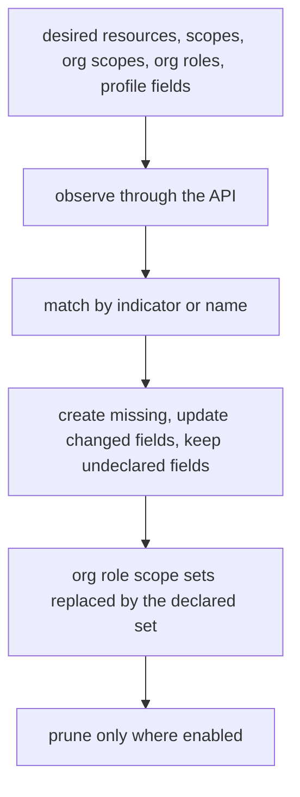

<!-- Fill or omit these sections; never add, rename, or reorder one. -->

# Instruction: kinds — resources and scopes, organization scopes and roles, custom profile fields

## Architecture projection

> Tree of the final files. ✅ create · ✏️ modify · ❌ delete

```txt
.
├── internal/engine/kinds/resources/            ✅ resources by indicator, scopes by name; prune opt-in
├── internal/engine/kinds/organizationscopes/   ✅ by name
├── internal/engine/kinds/organizationroles/    ✅ by name; organization and resource scope sets PUT as declared
├── internal/engine/kinds/customprofilefields/  ✅ by name; PUT without the name
├── internal/engine/kinds/*/wire.go              ✅ the kind's own request and response types, only the fields it manages
├── internal/engine/kinds/*/contract_test.go     ✅ every request body and recorded response validated against 1.44, 1.45, 1.46
├── internal/engine/kinds/*/kind_test.go        ✅ on logtofake: create, adopt, update one field, no-op, prune on/off
├── internal/engine/kinds/*/integration_test.go ✅ build tag `integration`: same cases on the real Logto
├── internal/logto/logtofake/                   ✏️ routes of these kinds, observed Logto behaviours
└── aidd_docs/memory/integration.md             ✏️ facts confirmed on the real Logto
```

## User Journey



## Test Scope

```mermaid
---
title: Test scope
---
journey
  section Setup
    empty Logto (fake, then real) => no declared object exists: 5: system
  section Happy path
    apply resources, scopes, org scopes, org roles, profile fields => every object created; second apply => zero writes: 5: system
  section Edge case - adoption
    an object with the declared name already exists => apply => adopted and updated, not duplicated: 1: system
  section Edge case - scope removal
    a scope removed from the document, prune off => plan => refused with "would revoke tokens": 1: system
  section Edge case - prune on
    an org role absent from the document, prune organizationRoles on => apply => role deleted: 1: system
  section Teardown
    task it:down => baseline restored: 5: cli
```

## Tasks to do

Every kind of this phase: its wire types live in `wire.go` (optional fields, omitted when undeclared), its calls go
through `client.Do`, its contract test validates each body it can send and each response fixture against the three
vendored specs, and the properties it sends are declared for the capability check. Its used operation ids are added
to `tools/specdiff/used.txt`.

### `1)` Resources and scopes

> API resources matched by indicator, their scopes by name.

1. Observe resources and each resource's scopes (paginated); create missing, update name and `accessTokenTtl`.
2. Scopes added and updated; removal only with `prune.resources` and never for the default Management API resource.
3. Unit tests on the fake, integration tests on the real Logto.

### `2)` Organization scopes and roles

> The organization template as declared.

1. Organization scopes by name; roles by name with description.
2. Role organization scopes and resource scopes `PUT` as the declared set (ids resolved from step 1 and this step).
3. Prune of roles only with `prune.organizationRoles`; tests on fake and real Logto.

### `3)` Custom profile fields

> Sign-up fields by name.

1. Create with `POST`, update with `PUT /api/custom-profile-fields/{name}` without the name; compare all declared keys.
2. Tests on fake and real Logto; record confirmed behaviours in `integration.md`.

## Test acceptance criteria

| Task | Acceptance criteria |
| ---- | ------------------- |
| all | The kind's contract test passes on 1.44.0, 1.45.0 and 1.46.0, and its integration tests pass on the newest version (pull request) and on all three (`main`). |
| 1 | On an empty real Logto, declared resources and scopes exist after apply; a second apply writes nothing; removing a scope without prune is refused at plan time. |
| 2 | Each organization role holds exactly its declared scopes after apply; an undeclared role is deleted only with prune enabled. |
| 3 | Declared profile fields exist with their declared config; changing a label updates only that field. |
