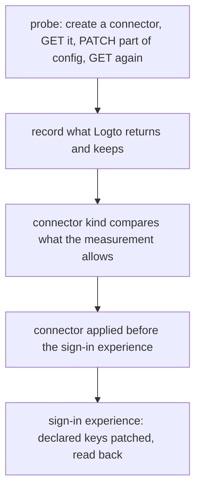

<!-- Fill or omit these sections; never add, rename, or reorder one. -->

# Instruction: kinds — SMTP connector and sign-in experience

## Architecture projection

> Tree of the final files. ✅ create · ✏️ modify · ❌ delete

```txt
.
├── test/integration/connector_probe_test.go     ✅ build tag `integration`: measures GET and PATCH behaviour (Q5)
├── internal/engine/kinds/connectors/            ✅ by declared id, else adopted by factory id when unique
├── internal/engine/kinds/signinexperience/      ✅ singleton, PATCH of declared keys only
├── internal/engine/kinds/*/wire.go              ✅ the kind's own request and response types, only the fields it manages
├── internal/engine/kinds/*/contract_test.go     ✅ every request body and recorded response validated against 1.44, 1.45, 1.46
├── internal/engine/kinds/*/kind_test.go         ✅ on logtofake
├── internal/engine/kinds/*/integration_test.go  ✅ on the real Logto
├── internal/logto/logtofake/                    ✏️ connector and sign-in experience routes, as measured
├── docs/plan.md                                 ✏️ Q5 and Q6 answered (section 13), gap 7 settled (section 10)
└── aidd_docs/memory/integration.md              ✏️ measured connector behaviour
```

## User Journey



## Test Scope

```mermaid
---
title: Test scope
---
journey
  section Setup
    real Logto from task it:up => no connector, default sign-in experience: 5: cli
  section Happy path
    apply an SMTP connector with templates and the sign-in experience (email, verify, branding, CSS, language) => both present; second apply => zero writes: 5: system
  section Edge case - measurement
    probe runs => the answers to "is auth.pass returned" and "does PATCH replace config" are asserted and recorded: 1: system
  section Edge case - email without connector
    email identifier with verify and no connector declared => plan => refused before any write: 1: system
  section Edge case - undeclared keys
    a sign-in experience key not in the document changed by hand => apply => left untouched: 1: system
  section Teardown
    task it:down => baseline restored: 5: cli
```

## Tasks to do

Every kind of this phase: its wire types live in `wire.go` (optional fields, omitted when undeclared), its calls go
through `client.Do`, its contract test validates each body it can send and each response fixture against the three
vendored specs, and the properties it sends are declared for the capability check. Its used operation ids are added
to `tools/specdiff/used.txt`.

### `1)` Measure the connector (Q5)

> Settle the write-only secret question on a real Logto before coding the comparison.

1. Probe test: create an SMTP connector with an `auth.pass`, `GET` it, `PATCH` only `templates`, `GET` again.
2. Assert and record: whether `auth.pass` is returned (or masked), whether `PATCH` replaces or merges `config`.
3. Write the result in `integration.md` and settle gap 7 and Q5 in `docs/plan.md`.

### `2)` Connector kind

> The SMTP connector as declared, its secret compared only as far as Logto allows.

1. Match by declared id; adopt by `connectorId` when exactly one exists; ambiguity is a plan error.
2. Send the full `config` when the measurement says PATCH replaces; compare the secret per the measurement (compare, or report as write-only without a write when unchanged elsewhere, as decided in task 1).
3. Templates from `fromDir`; tests on fake and real Logto.

### `3)` Sign-in experience kind

> Only the declared keys are owned.

1. Observe `GET /api/sign-in-exp`, diff declared keys only, `PATCH` them, read back and fail if not kept.
2. Branding by `fromFile` as data URI, `customCss` from file, `languageInfo`, identifiers, `unknownSessionRedirectUrl`.
3. Depends on connectors; plan refuses an email identifier with verify when no email connector is declared or present.

## Test acceptance criteria

| Task | Acceptance criteria |
| ---- | ------------------- |
| all | The kind's contract test passes on 1.44.0, 1.45.0 and 1.46.0, and its integration tests pass on the newest version (pull request) and on all three (`main`). |
| 1 | The probe states, from the real Logto, whether `auth.pass` is returned and whether `PATCH` replaces `config`; the answers are in `integration.md` and `docs/plan.md`. |
| 2 | The connector exists with its templates after apply; a second apply writes nothing; a changed password is applied per the measured rule. |
| 3 | The declared sign-in experience keys hold their values after apply; an undeclared key changed by hand is untouched; the email-without-connector case is refused at plan time. |
