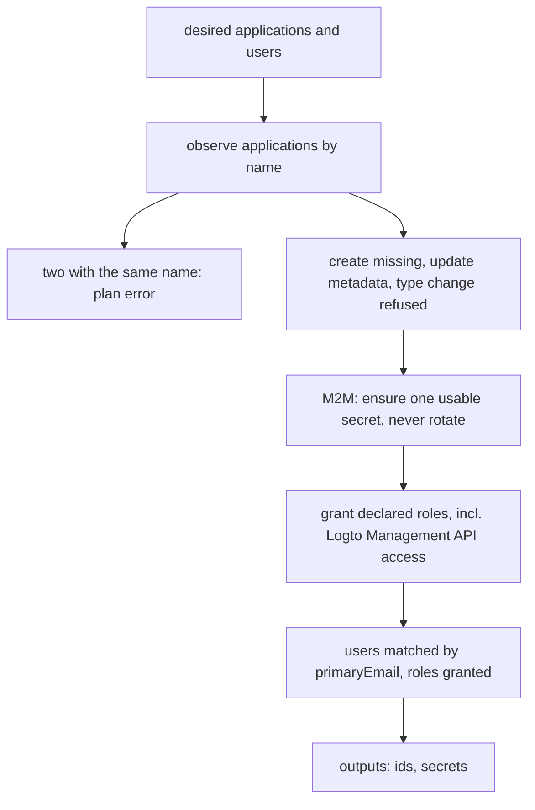

<!-- Fill or omit these sections; never add, rename, or reorder one. -->

# Instruction: kinds — applications (secrets, role grants) and admin users; outputs

## Architecture projection

> Tree of the final files. ✅ create · ✏️ modify · ❌ delete

```txt
.
├── internal/engine/kinds/applications/          ✅ adopt by name, metadata merge, M2M secret, role grants
├── internal/engine/kinds/users/                 ✅ by primaryEmail, global roles granted, never a password
├── internal/engine/kinds/*/wire.go              ✅ the kind's own request and response types, only the fields it manages
├── internal/engine/kinds/*/contract_test.go     ✅ every request body and recorded response validated against 1.44, 1.45, 1.46
├── internal/engine/kinds/*/kind_test.go         ✅ on logtofake
├── internal/engine/kinds/*/integration_test.go  ✅ on the real Logto
├── internal/outputs/
│   ├── outputs.go                               ✅ ids and secrets collected from an apply
│   ├── write.go                                 ✅ ids as KEY=value or JSON; secrets to a 0600 file or an fd
│   └── outputs_test.go                          ✅
├── internal/logto/logtofake/                    ✏️ applications, secrets, roles, users routes
└── aidd_docs/memory/integration.md              ✏️ confirmed behaviours
```

## User Journey



## Test Scope

```mermaid
---
title: Test scope
---
journey
  section Setup
    real Logto from task it:up => only Logto's built-in applications: 5: cli
  section Happy path
    apply SPA, M2M with the Management API role, a user with a role => all exist; the M2M obtains a Management API token with the published secret: 5: system
    second apply => zero writes, same secret published: 5: system
  section Edge case - adoption
    an application with the declared name exists => apply => adopted, id unchanged, not recreated: 1: system
  section Edge case - type change
    declared type differs from Logto's => plan => refused as immutable: 1: system
  section Edge case - duplicate name
    two Logto applications share the declared name => plan => refused as ambiguous: 1: system
  section Edge case - secrets out
    outputs written => ids on stdout, secrets only in the 0600 file, never on stdout or stderr: 1: cli
  section Teardown
    task it:down => baseline restored: 5: cli
```

## Tasks to do

Every kind of this phase: its wire types live in `wire.go` (optional fields, omitted when undeclared), its calls go
through `client.Do`, its contract test validates each body it can send and each response fixture against the three
vendored specs, and the properties it sends are declared for the capability check. Its used operation ids are added
to `tools/specdiff/used.txt`.

### `1)` Applications

> Adopted by name, never deleted or recreated.

1. Observe applications (paginated); match by name; ambiguity and `type` change are plan errors.
2. Update description, OIDC and custom client metadata (undeclared keys kept); redirect URIs compared as sets.
3. Built-in applications (`m-default`, admin apps) are never touched or pruned.

### `2)` M2M secrets and role grants

> Secrets are outputs; Management API access is a declared grant.

1. No usable secret: create one (`POST /api/applications/{id}/secrets`), read it back; otherwise publish the existing one.
2. Grant declared roles through `/api/roles/{id}/applications`; the built-in role found by name, a missing role fails the plan.
3. Integration test: the published secret obtains a Management API token.

### `3)` Users

> Application-level admins only.

1. Match by `primaryEmail`; create without a password; update name; grant declared global roles.
2. Never pruned; never a password in the document or the API calls.

### `4)` Outputs

> Ids are printable, secrets are not.

1. Collect ids (applications, resources' indicators) and secrets (M2M secrets) from the apply.
2. Ids as `KEY=value` on stdout or JSON (`--outputs json` in phase 7); secrets to `--secrets-out` (0600, mode enforced on an existing file) or `--secrets-fd`.

## Test acceptance criteria

| Task | Acceptance criteria |
| ---- | ------------------- |
| all | The kind's contract test passes on 1.44.0, 1.45.0 and 1.46.0, and its integration tests pass on the newest version (pull request) and on all three (`main`). |
| 1 | An existing application with the declared name keeps its id after apply; a type change and a duplicate name are refused at plan time. |
| 2 | The M2M application has exactly one usable secret after two applies, and that secret gets a Management API token from the real Logto. |
| 3 | The declared user exists with its roles and no password was sent; a second apply writes nothing. |
| 4 | Secrets land only in a 0600 file or the given fd; stdout and stderr contain no secret value. |
