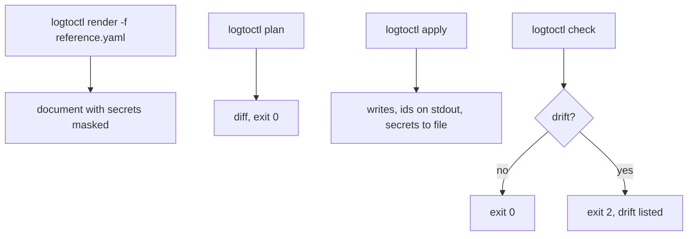
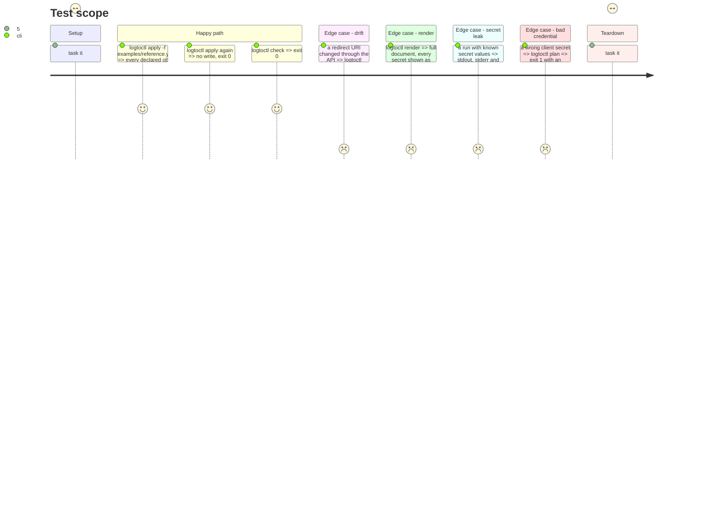

<!-- Fill or omit these sections; never add, rename, or reorder one. -->

# Instruction: CLI commands and the M1 acceptance scenarios

## Architecture projection

> Tree of the final files. ✅ create · ✏️ modify · ❌ delete

```txt
.
├── cmd/logtoctl/main.go                 ✏️ subcommands plan, apply, check, render, version; exit codes
├── internal/cli/
│   ├── commands.go                      ✅ flags, wiring config -> secrets -> client -> engine -> outputs
│   └── commands_test.go                 ✅ on logtofake: exit codes, outputs, no secret in any stream
├── test/integration/acceptance_test.go  ✅ build tag `integration`: the M1 acceptance on examples/reference.yaml
├── docs/usage.md                        ✅ how to run logtoctl, the bootstrap routes, exit codes
├── docs/plan.md                         ✏️ M1 status, decisions Q3, Q4, Q6 and the compose harness recorded
└── aidd_docs/memory/cli.md, testing.md, codebase-map.md, architecture.md ✏️ current state after M1
```

## User Journey



## Test Scope



## Tasks to do

### `1)` Commands

> Four verbs, one engine.

1. `plan`, `apply`, `check`, `render`, `version`; `-f` for the document; credentials and secrets only from env or files.
2. Exit codes: 0 ok or in sync, 1 error, 2 drift (`check`), 3 applied with warnings (`apply`).
3. `--secrets-out`, `--secrets-fd`, `--print-secrets` (warned), `--outputs json`.

### `2)` CLI tests on the fake

> The contract of the binary.

1. Exit codes, plan output, outputs files, mode 0600.
2. Leak test: every known secret value absent from stdout, stderr and logs.

### `3)` Acceptance on the real Logto

> The M1 definition of done, automated.

1. `acceptance_test.go` runs the built binary against the harness with `examples/reference.yaml`: apply, object-by-object assertions, second apply without writes, check 0, edit through the API, check 2, render without secrets.
2. Runs in `task it` and the `integration` workflow.

### `4)` Documentation and memory

> What is true after M1, for people and for agents.

1. `docs/usage.md`: install, supported Logto versions (the window and how it moves), bootstrap routes (`m-default`, dedicated M2M), commands, exit codes, secrets handling.
2. `docs/plan.md`: M1 marked done, Q3, Q4, Q6, the compose harness and the support window recorded as decisions.
3. Memory files updated to the current state.

## Test acceptance criteria

| Task | Acceptance criteria |
| ---- | ------------------- |
| 1 | Each command returns the documented exit code; no flag accepts a secret value. |
| 2 | On the fake, outputs and exit codes match the contract and no secret value appears in any stream. |
| 3 | On an empty real Logto of each supported version: reference applied, second apply writes nothing, check 0 then 2 after an edit, render masks every secret. |
| 4 | `docs/usage.md` lets a newcomer run `plan` against a local Logto; the plan and memory state M1 as done. |
